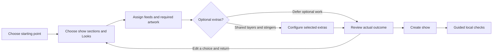

# Pulse Weaver setup wizard: onboarding and visual audit

Historical pre-rebuild audit. See the [implemented rebuild and verification notes](<SETUP-WIZARD-REBUILD-2026-10-25.md>) for current behavior. Source line references below describe the recorded baseline before these files were rebuilt.

25 October 2026 · Current regular 2.0 unstable wizard · Research and review, not an implemented redesign

## Judgment

The wizard has useful underlying capabilities, but its later pages ask the user to manage too many different tasks at once. It starts as a preparation guide, becomes a layout editor, then combines source assignment, troubleshooting, animation timing and final review. The strongest improvement would be a clearer sequence of decisions, supported by better previews and honest status messages. Another round of button styling alone would leave the principal problems intact.

The stage-group cards are already a reasonable foundation. The most consequential work is on Look configuration, source assignment, error recovery and the handoff after creation. Preserve dual canvases, native motion, stingers, multistream and Lumia compatibility while making those choices easier to understand.

Companion documents:

- [Annotated onboarding research][research]: eight primary sources, their limits, and implications for Pulse Weaver.
- [Detailed source audit][source-audit]: implementation evidence, exact code references, assignment counts, validation behavior and suggested copy.

## What was checked

Research covered university HCI teaching, a CHI learnability paper, official onboarding guidance, accessible multi-step entry, review and recovery, and desktop wizard behavior. The university material emphasizes discovery, understanding and memory; the service-design material supports focused decisions and editing answers without replaying the entire journey. These sources inform the proposed design; they do not establish that a particular Pulse Weaver layout has passed usability testing. [MIT learnability](https://designftw.mit.edu/lectures/learnability/index.html), [GOV.UK question pages](https://design-system.service.gov.uk/patterns/question-pages/), [GOV.UK check answers](https://design-system.service.gov.uk/patterns/check-answers/).

The source review covered the active four-page wizard, its flexible-layout, source-choice and stinger helpers, creation backend and setup guide. The baseline was `e6c4bc12c7f40970730ae2d4ed833aab54ad7855`, with the existing local main-panel and settings fixes retained.

The native walkthrough used an isolated, empty instance with the current installed frontend, core and themes. It covered all four primary pages, expanded Look options, transition controls, the stinger dialog, source navigation, the empty existing-source chooser, a new-source dialog, Back/Next preservation and the final summary. The wizard was cancelled; Create my show was never invoked. No source was created, no camera capture was opened and no broadcast or recording was started. The main installation and existing show were not edited.

After cancellation, fixture verification found zero inputs, scene items, service files or wizard-created Stages. The disposable runtime was removed and evidence retained; the installed application remained running.

Evidence labels below mean:

- **Observed:** reproduced in the native walkthrough.
- **Source:** established by implementation review, not reproduced in a populated native fixture.
- **Proposal:** a design hypothesis to implement and evaluate.

The observed wizard was approximately 1042 × 852 pixels in a larger desktop window. A resize attempt did not establish a smaller test size. High DPI, enlarged text, screen readers, a populated saved-layout branch, every Look permutation, live output and performance under game load remain untested. No numerical CPU/RAM saving is claimed.

## Findings, in priority order

Priority 1 means resolve before presenting the next wizard revision as dependable onboarding. Priority 2 means address in the interaction/visual redesign. These are audit priorities, not claims of a production crash or data loss.

| Priority | Finding and evidence | Recommended correction |
|---|---|---|
| 1 | **Completion and repair can disagree.** Source: the required count and attention button validate individual assignments; final validation additionally rejects overlapping shared-layer reuse and retained-layout conflicts. All required inputs can appear complete while creation remains blocked with no corresponding attention target. | Use one validation result for the count, final action, field errors and repair navigation. Identify both sides of a conflict and provide a direct fix action. |
| 1 | **“Ready” overstates the check.** Observed: entering `https://example.invalid/countdown-h` advanced the count to 1 of 9. Source: this is HTTP(S) format validation, not a connection/content test; the backend also accepts that format. Newly created browser sources start with output audio off; existing source audio settings are preserved. | Say **assigned**, separately show **not tested**, and explain audio consequences before creation. Keep generic browser support. |
| 1 | **The final review does not consolidate the consequential choices.** Observed: “Review source assignments” opens a searchable index of 19 question labels without their assigned values or status. The bottom summary gives stage/Look totals and diagrams, with important post-creation work in paragraphs. | Provide a dedicated outcome review with actual source names, shared/new instances, additions, unresolved issues and contextual Edit actions. Separate this from the question navigator. |
| 2 | **Selecting a Look does not preview that Look.** Observed: selecting Welcome left the diagram caption and content on Countdown. Source: the selection toggle changes inclusion; other interactions change the preview. | Make preview and inclusion separately identifiable. A card body can preview; an explicit include control can select. Keep the visible preview synchronized with its title. |
| 2 | **Expanded Look configuration uses space poorly.** Observed: a long set of option cards expands inside the left half of a two-column grid, leaving the other half largely empty while the preview scrolls away. | Open focused Look configuration with the selected preview alongside the current question. Return to the originating card with its updated summary. |
| 2 | **Preparation hides its most useful permission to proceed.** Observed: checkboxes are nonblocking, but the explanation that they are reminders is below the initial fold. Specialist/legacy guidance appears before the basic route is established. | Put “plan now / connect Lumia later” and the real requirements at the top. Move specialist setup into contextual help for the selected feature. |
| 2 | **Source questions require recall.** Observed: “Game · Feed B” gives a technical slot name and a generic source paragraph. Creating that source defaults to Camera, although the slot is the main content feed for Gameplay. | Lead with the feed's purpose and affected Looks; retain A/B/C as secondary stable identifiers. Offer a contextual source-type choice without forbidding other supported inputs. |
| 2 | **Small labels promise the wrong action or guidance.** Observed: “Paste Lumia link” opens an empty field, yet immediately says it is using a pasted link. The empty source chooser says to create a “source or stinger,” and offers only Cancel. | Use Enter browser link, truthful empty/entered states and context-specific empty results with a direct next action. |
| 2 | **The error can refer to a different question.** Observed: choosing URL mode for empty landscape artwork changed the footer to missing portrait artwork. In Game Feed B, the footer still named the earlier portrait assignment. Source: missing choice IDs are checked before current URL contents. | Explain the current field locally. Keep any overall issue summary distinct, with a named jump action rather than a disconnected footer sentence. |
| 2 | **Reuse is available but too easy to miss.** Source: entering the same same-orientation URL independently for different questions produces separate browser definitions; selecting the same existing source/draft reuses it. Sources stay warm intentionally. | Suggest reusing an equivalent source and explain shared content/settings versus independent state. Do not automatically merge by host or shut down hidden Lumia browsers. Measure any resource benefit. |

Implementation evidence for the first three findings is in [assignment progress][progress], [final cross-question checks][conflicts] and [browser creation/audio behavior][browser]. The detailed source audit also records generated-name collisions and the saved-layout graph constraints, which need more than a cosmetic change.

## Visual quality and formatting

The observed baseline did **not** show a general overlap or clipping failure. The official Lumia logo was crisp, the six stage-group cards were readable, and the stinger dialog explained its cut point clearly. Normal content scrolling is not itself a formatting bug.

The less polished appearance comes from hierarchy and composition:

- Preparation uses many similarly weighted paragraphs and full-width buttons. Important reassurance competes with advanced setup instructions.
- Stage-group selection has clean spacing, but selection relies heavily on the outline/accent. Add a clear tick or Included state and retain visible keyboard focus.
- Page 3 gives a large block to schematic preview, then buries relevant configuration below it. Expanded controls inherit a half-width card column that is unsuitable for the full editing task.
- Previous stage / Next stage sits alongside global Back / Next. The different navigation scopes are easy to confuse; boundary stage buttons can do nothing. Use named actions such as Configure this Look, Assign sources and Back to Looks.
- Page 4's large diagrams compete with the assignment being made. They explain placement, but are flat rectangles with technical labels rather than an attractive example of the result. Keep truthful schematic labels; add lightweight illustrative thumbnails where they aid selection.
- The final paragraphs mix retained layouts, alert layers, transitions, rehearsal and Lumia commands. Present the immediate outcome and remaining work as distinct, actionable sections.

Source-only formatting risks include fixed 220-pixel title wrapping, small text after diagram scaling, long unbroken source names and geometry affected by expanded hidden tabs. These require additional rendered tests; they are not claimed as observed clipping defects. [Choice-card sizing][choice-sizing], [Look preview construction][preview].

## Interaction load and optional work

The default selection is five groups with six Looks. Its source inventory contains **19 questions: 9 required and 10 optional**. This is not a mandatory 19-click path: attention navigation skips optional omissions and empty optional layers create no source.

A minimal Chat show still has seven questions: one required feed and six optional shared layers. All six layers are appended regardless of whether the user intends to use them. Offer an explicit “Add shared alerts or overlays?” decision, and reveal only the requested slots. Offer a minimal starting route without forcing the user to deselect most defaults. Do not remove advanced functionality or silently prune retained saved-layout sources. Exact inventory and constraints are documented in the source audit.

## Proposed click-through journey

This is an expanded scope recommendation, not a fixed page-count target or an implemented flow. Keep small, relevant choices visible; disclose configuration when the user asks for it. The preference for click-through interaction is the user's product requirement. Research does not prove that all lists are bad or that fewer clicks always produce better usability.

| Phase | What the user sees | What stays available |
|---|---|---|
| Starting point | A useful minimal show, a fuller starting arrangement, or reuse of an existing layout. A compact Stage/Look example explains the result. | Custom selection; existing layout preservation. |
| Sections and Looks | A small set of stage cards, then focused Look selection with illustrative thumbnails. Preview and inclusion have distinct controls. | All supported Looks and an obvious Configure action. |
| Feeds | “Main game/content view,” “Supporting camera or content,” and similarly meaningful prompts, showing affected Looks and whether optional. | Existing/new sources and all supported input types; clear reuse. |
| Selected features | Only requested artwork, shared layers and transitions. One compact H/V explanation; each choice shows its effective default. | Separate canvas policies, stinger timing, detailed placement and native motion. |
| Review | Real assignments and source sharing, what is added, what stays unchanged, conflicts and deferred work. Each section has Edit and returns directly to review. | No forced replay of completed answers. |
| Completion | “Show created,” then explicit local visual/audio/transition checks and links to finish Lumia commands. | Existing output/account setup remains accessible; broadcasting is a separate action. |

The route need not demand a real camera, a connected Lumia installation or optional integrations for a feed-only plan. Conversely, a selected Lumia-dependent Look still needs its required artwork assignments. Both canvases are a current product constraint; explain them without implying two copies of every ordinary feed are necessary.

## Copy that should change first

| Current situation | Proposed copy |
|---|---|
| Preparation status | “You can plan your show now and finish Lumia setup later. These checkboxes are reminders, not connection tests.” |
| Game Feed B | “Choose the main game or content view for Gameplay. Feed B is used in both canvases; its placement can differ.” |
| Link mode, empty | “Enter the browser link copied from Lumia. Import the template first, then use Lumia's chain/copy-link button.” |
| Assignment status | “1 of 9 required assignments complete. These sources have not been tested.” |
| No compatible existing source | “No compatible sources are available yet.” Actions: Create a source / Back. Search-with-no-results needs different wording. |
| Review commitment | “Create these Stages, Looks and new sources.” Explain current-show effects and that this action does not start a broadcast. |
| Completion audio reminder | “New browser sources start with output audio off. Choose the intended audio owner and monitoring route, then check headphones and stream audio.” |

“Assigned,” “created,” “checked in a local preview,” and “verified on the live destination” must remain distinct. Do not auto-enable every duplicate browser's sound or assume monitoring is the correct route for every show. Preserve the user's intended Lumia monitoring/output behavior across transitions.

## Scope expansion worth doing

1. **A reusable source decision:** make reuse discoverable before allocating more browser instances. This addresses both comprehension and the user's resource concerns without promising unmeasured savings.
2. **A recovery model:** preserve Back/Next drafts, add direct review edits, and consider resumable drafts. Current in-session Back/Next retained the source question and URL draft; closing/resuming is not implemented or tested.
3. **A completion handoff:** distinguish structural creation from visual, audio, transition and destination checks. Local tests need an explicit scope and initiation; setup should not silently start output or playback. A local rehearsal cannot certify delivery or gaming headroom.
4. **A shared quality standard:** consistent card selection/focus states, content-sized controls, readable diagram labels, contextual help, source-specific empty states and named navigation across wizard and dialogs.

Use static or cached illustrations for option browsing. If a real preview is added, bound it to one selected, deliberate preview and measure its lifecycle/cost. The existing diagrams do not start parallel media or browser previews, which is worth preserving. Do not trade RAM for repeated decoding or disrupt warm Lumia widget state, stingers or multistream routes merely to improve an idle measurement.

## Validation for the next implementation

These are proposed acceptance checks, not completed results:

- The assignment count, attention navigation, error summary and Create state agree for missing inputs, invalid URLs and cross-layer conflicts. Each issue leads to its editable control.
- Look preview/inclusion are unambiguous. Returning from options preserves the selection and restores a sensible place/focus.
- Default, minimal and saved-layout routes expose only relevant work while preserving required retained-graph constraints. Optional omissions remain explicitly deferred.
- Review shows actual values and new/shared instance consequences; an edit returns directly to review. Cancelling applies nothing.
- Keyboard-only navigation, accessible selected states/names, error announcements, long labels, enlarged text and constrained windows work across all pages and dialogs. Web accessibility guidance must be translated and tested in native Qt; it is not a conformance certificate. [W3C notifications](https://www.w3.org/WAI/tutorials/forms/notifications/).
- First-time users attempt a concrete show goal independently; record success, assistance, misunderstanding and recovery. A separate coached follow-up can investigate deeper learning. Do not mix coached completion with independent success.
- Compare sources/processes and CPU/RAM before opening, during browsing and after closing; separately test authorized media/audio/encoding. Verify stingers, native motion, Lumia audio/commands and output configuration survive the redesign.

Existing native screenshot automation checks only the stage-group page, not the full wizard. Headless builder tests exercise important behavior but do not validate typography, scrolling or onboarding comprehension. This audit did not rerun those suites or claim new release certification. [Existing visual audit coverage][visual-tests].

## External-link and evidence limits

The [official Lumia download page](https://www.lumiastream.com/downloads) resolved during research. The companion plugin button uses a hardcoded 1.4.4 asset under GitHub's latest-release redirect. The web tool could not retrieve that binary URL, so this review does **not** establish either successful delivery or a broken download. Verify the resolved release asset before the revised wizard ships. No external download button was clicked in the native walkthrough.

The source audit contains additional saved-layout, generated-name and guide-drift findings. They remain source findings until their populated native paths are exercised. The native review confirmed substantial hierarchy, wording and interaction problems, not a blanket claim that every page is malformed.

[research]: <SETUP-WIZARD-ONBOARDING-RESEARCH-2026-10-25.md>
[source-audit]: <SETUP-WIZARD-SOURCE-AUDIT-2026-10-25.md>
[progress]: <https://github.com/darylbwickham-design/pulse-weaver-studio/blob/e6c4bc12c7f40970730ae2d4ed833aab54ad7855/engine/obs-studio/plugins/pulse-weaver-core/pulse-setup-flexible.hpp#L150>
[conflicts]: <https://github.com/darylbwickham-design/pulse-weaver-studio/blob/e6c4bc12c7f40970730ae2d4ed833aab54ad7855/engine/obs-studio/plugins/pulse-weaver-core/pulse-setup-flexible.hpp#L867>
[browser]: <https://github.com/darylbwickham-design/pulse-weaver-studio/blob/e6c4bc12c7f40970730ae2d4ed833aab54ad7855/engine/obs-studio/plugins/pulse-weaver-core/pulse-show-builder.cpp#L1984>
[choice-sizing]: <https://github.com/darylbwickham-design/pulse-weaver-studio/blob/e6c4bc12c7f40970730ae2d4ed833aab54ad7855/engine/obs-studio/plugins/pulse-weaver-core/pulse-setup-choices.hpp#L17>
[preview]: <https://github.com/darylbwickham-design/pulse-weaver-studio/blob/e6c4bc12c7f40970730ae2d4ed833aab54ad7855/engine/obs-studio/plugins/pulse-weaver-core/pulse-setup-flexible.hpp#L412>
[visual-tests]: <https://github.com/darylbwickham-design/pulse-weaver-studio/blob/e6c4bc12c7f40970730ae2d4ed833aab54ad7855/engine/obs-studio/shared/qt/PulseUiLayoutAudit.hpp#L464>
